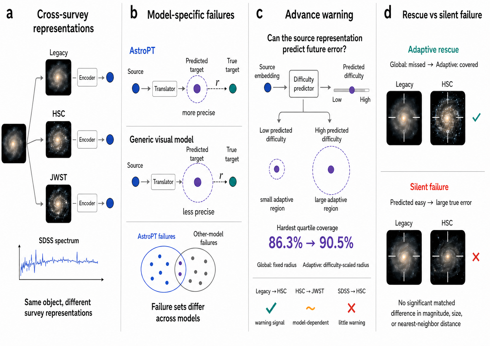

# Do Astronomical Foundation Models Know When They Will Fail?

Code for **"Do Astronomical Foundation Models Know When They Will Fail?"** — an interpretable conformal-prediction framework for auditing whether astronomical foundation-model embeddings of the *same object* stay reliable when transferred across surveys, and whether a representation can warn us in advance that it's about to fail.



## Overview

The same galaxy looks very different depending on the survey that imaged it — different depth, resolution, wavelength coverage, and observing conditions. This project asks: if we learn to translate one survey's embedding of an object into another survey's embedding, how much can we trust that translation, which objects break it, and can the source embedding warn us before it fails?

Using cross-matched objects from **Legacy Survey → HSC**, **HSC → JWST**, and **SDSS → HSC**, we:

- **Benchmark cross-survey transfer** across astronomy-specific (AstroPT) and general-purpose visual backbones (ConvNeXt, DINOv2, ViT, I-JEPA) using three independent translators (ridge regression, k-NN, SVR).
- Show that **global conformal prediction is well calibrated** (close to nominal 80/90/95% coverage) but that **different model families fail on different objects**, even at matched coverage.
- Test whether the **source embedding already contains a warning signal** about its own future translation error, using residual-normalized adaptive conformal prediction.
- Separate **adaptive rescues** (recovered once uncertainty adapts to predicted difficulty) from **silent failures** (large error with no warning), and check whether these categories are explained by simple observables (magnitude, size, nearest-neighbor distance, PSF).

**Key findings:** AstroPT gives consistently lower translation error and tighter conformal regions than general-purpose backbones. The warning signal is strong for Legacy→HSC (ρ = 0.25–0.42), backbone-dependent for HSC→JWST, and largely absent for SDSS→HSC — adaptive calibration only helps where the signal is informative. Silent failures are not explained by magnitude, apparent size, or nearest-neighbor distance, so their cause remains an open question.

## Data

All embeddings and cross-matched splits are hosted on Hugging Face: **[astro-conformal-project](https://huggingface.co/astro-conformal-project)**.

| Survey pair | HF dataset |
|---|---|
| Legacy Survey → HSC | `astro-conformal-project/split_legacysurvey_hsc_embeddings` |
| HSC → JWST | `astro-conformal-project/split_jwst_hsc_embeddings` |
| SDSS → HSC | `astro-conformal-project/split_sdss_hsc_embeddings` |

Most loaders stream directly from Hugging Face and require a token with read access:

```bash
export HF_TOKEN=hf_your_token_here
```

## Repository Structure

```text
.
├── SVR/                          # Support-vector regression translator + conformal/residual experiments
│   ├── src/                      # Data loading, metrics, plotting, model constants
│   ├── experiments/               # Entry-point scripts (residual + conformal experiments)
│   └── results/                  # Residuals and uncovered-object CSVs
│
├── knn_regression/                # k-NN translator, split conformal prediction (Experiment 3)
│
├── ridge-regression/               # Ridge regression baseline
│   ├── cross-survey-translation/  # Translator training
│   ├── conformal-prediction-analysis/ # Conformal evaluation at 80/90/95% thresholds
│   └── src/                       # Shared helpers
│
├── ridge_basket_experiment/        # Ensemble ("basket") ridge translators, rescue-rate & seed-stability analysis
│
├── adaptive-conformal/              # Experiment 4: residual-normalized adaptive conformal prediction
│   ├── configs/                   # Per-survey-pair YAML configs
│   └── run_adaptive_cp.py         # Main entry point
│
└── overview.png                         # Figures used in README
```

Each of `SVR/`, `knn_regression/`, and `ridge-regression/` also has its own README with translator-specific details.

## Installation

Each sub-project ships its own `requirements.txt`. From the repo root:

```bash
# SVR experiments (also needs an NVIDIA GPU + CUDA 12 for cuml.accel)
pip install -r SVR/requirements.txt

# Ridge regression baseline
pip install -r ridge-regression/requirements.txt

# k-NN regression (Experiment 3) — no requirements.txt, install directly:
pip install numpy pandas scikit-learn datasets
```

`adaptive-conformal/` and `ridge_basket_experiment/` reuse the same core stack (`numpy`, `pandas`, `scikit-learn`, `datasets`, `scipy`); installing the ridge-regression requirements covers them.

Python 3.9+ is required; `knn_regression` specifically needs `numpy >= 1.22` for `compute_conformal_quantile(method="inverted_cdf")`.

## Running Experiments


### Ridge regression baseline

```bash
python3 ridge-regression/cross-survey-translation/train_kfold_ridge.py
python3 ridge-regression/conformal-prediction-analysis/conformal_prediction.py
```
### SVR (residuals + global conformal prediction)

```bash
cd SVR
# Residual-norm accuracy, all 16 models, Legacy Survey -> HSC
python experiments/residual_experiment_SVR.py --survey legacy --out results/legacy_hsc_residuals.csv

# Conformal coverage, a subset of models, JWST -> HSC
python experiments/conformal_experiment_SVR.py --survey jwst \
    --models dino_base,vit_large --alpha 0.10 --out results/jwst_hsc_conformal.csv
```

### k-NN regression (split conformal prediction)

```bash
cd knn_regression
python run_experiment.py                                  # all survey pairs × 16 backbones × 3 coverage levels
python run_experiment.py --pairs sdss_hsc --models astropt_15m dino_small   # quick smoke test
```

### Adaptive conformal prediction (Experiment 4)

```bash
cd adaptive-conformal
# Start small: one backbone, one coverage level
python run_adaptive_cp.py --dataset jwst_hsc --config astropt_850m --coverage 90

# Full sweep
python run_adaptive_cp.py --dataset all --config all --coverage 80 90 95
```

Survey-pair configs (embedding paths, PCA dimension, ridge alpha, split fractions) live in `adaptive-conformal/configs/*.yaml` — update the embedding paths there for your environment before running.

## Citation

This code accompanies a paper currently under anonymous review at NeurIPS 2026. A citation entry will be added once the paper is public.

